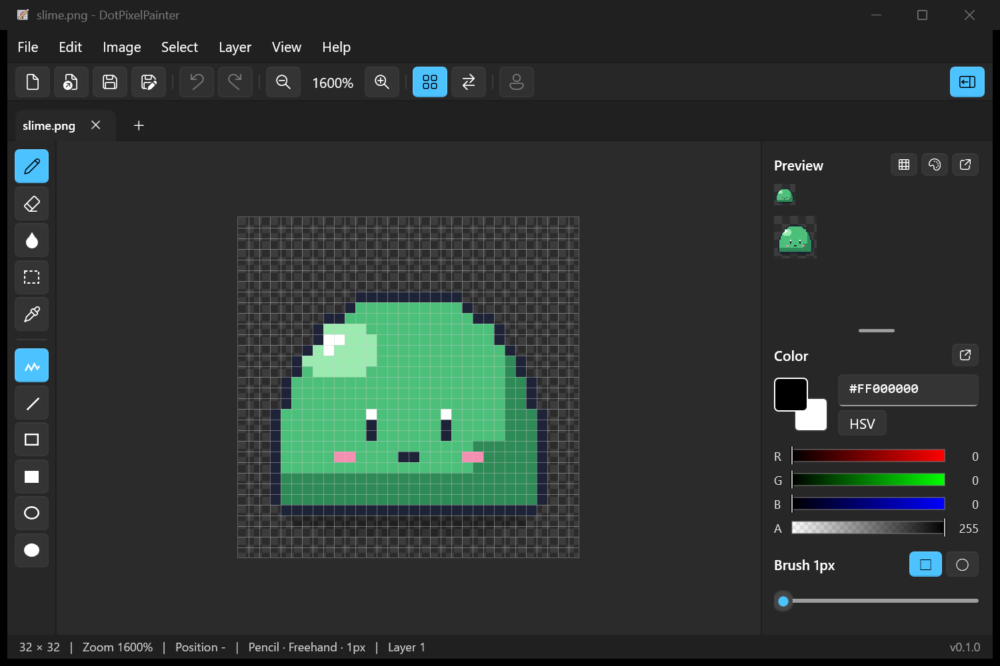
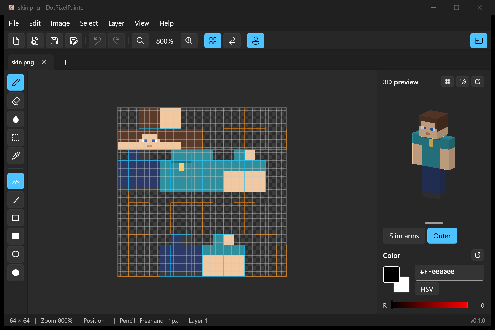

# DotPixelPainter

[日本語](README.md) | English

A lightweight pixel art editor for Windows 11 that starts fast. It can also edit Minecraft skins.
It starts in about half a second and needs no installation.



## Features

**Drawing**
- Pencil, eraser, fill, eyedropper, line, rectangle and ellipse (outline or filled)
- Brush size and shape (square or round)
- Dither pattern fill (75%, checker, 25% and more), optionally filling the gaps with the background color
- Pixel perfect: removes the extra pixel in L-shaped corners of 1px lines as you draw
- Color mask: protect chosen colors, or paint only over chosen colors

**Viewing**
- 1px grid lines and whole-number zoom that keeps pixels sharp
- 1x and 2x preview, and a 3×3 tiled view
- Mirror view, and a choice of transparency display (checkerboard, white, black and more)

**Color**
- RGB and HSV sliders, custom palettes (load and save GIMP .gpl)
- Shades: automatically lines up colors from shadow to highlight
- Replace color, reduce colors, add the colors used in the image to the palette

**Editing**
- Layers (add, duplicate, reorder, merge, opacity)
- Selection, move, copy and paste (also with other apps), flip and rotate
- Resize image, resize canvas, crop, flip and rotate the whole image
- Clean up lines (fix the corners of lines you have already drawn)
- Undo and redo (Ctrl+Z / Ctrl+Y)

**Files**
- Its own `.dotpix` format (keeps layers) and PNG. PSD files can be opened too
- Tabs, drag and drop, reopening the last tabs at startup
- Export PNGs scaled up 2 to 16 times with sharp pixels
- Split view: show a reference (another tab or an image) on the right, and click it to pick colors
- `.dotpix` thumbnails in Explorer (after registering from the Help menu)
- Panels can be detached into separate windows. The right panel folds automatically when the window is narrow

**Minecraft skins**

64×64 and 64×32 images can be edited as skins. The layout shows guides for each body part, and a 3D preview appears on the right (drag to rotate). You can switch between classic and slim arms and show or hide the outer layer.



**Language**

The app uses Japanese when Windows is set to Japanese, and English otherwise. You can change it in Help > 言語 / Language.

## Download

Download a zip from [Releases](https://github.com/Yocchan1513/DotPixelPainter/releases), extract it, and run `DotPixelPainter.exe`. No installation is needed.

| File | For |
| --- | --- |
| `DotPixelPainter-<version>-win-x64.zip` | Most PCs (Intel, AMD). Pick this if unsure |
| `DotPixelPainter-<version>-win-arm64.zip` | ARM PCs such as Snapdragon (e.g. Surface Pro 11) |
| `…-lite.zip` | Lite version for PCs that already have Windows App Runtime 2.5 or later |

The app is not signed, so the first time you run it Windows may show "Windows protected your PC". Click "More info" and then "Run anyway".

## Requirements

- Windows 11 (x64 / ARM64)
- The lite version also needs [Windows App Runtime](https://learn.microsoft.com/windows/apps/windows-app-sdk/downloads) 2.5 or later

## Building

You need the .NET 10 SDK and the "WinUI application development" workload of Visual Studio.

```powershell
dotnet build src/DotPixelPainter.App
```

Release zips are made with `./tools/package.ps1`. Native AOT also needs the "Desktop development with C++" workload, and the ARM64 build tools for the ARM64 version.

See [CLAUDE.md](CLAUDE.md) (Japanese) for development notes.

## License

[MIT License](LICENSE). The licenses of the libraries it uses are in [THIRD-PARTY-NOTICES.md](THIRD-PARTY-NOTICES.md).
